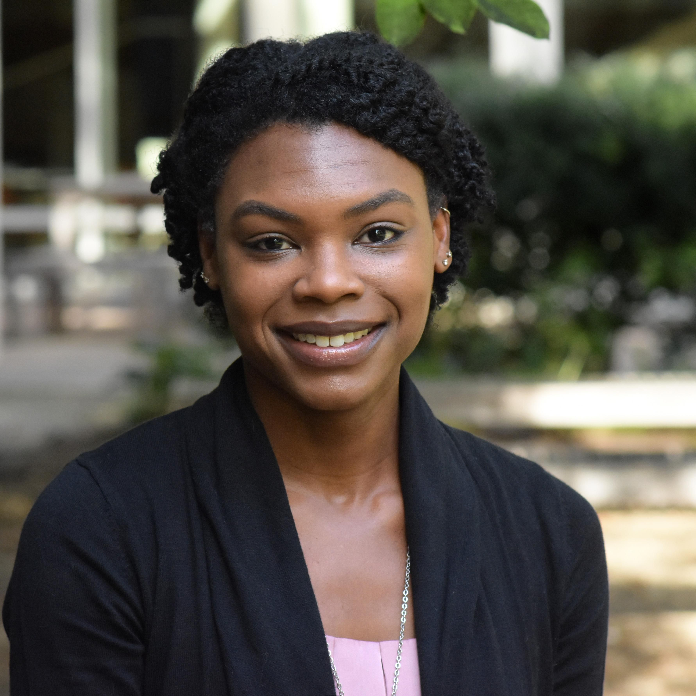
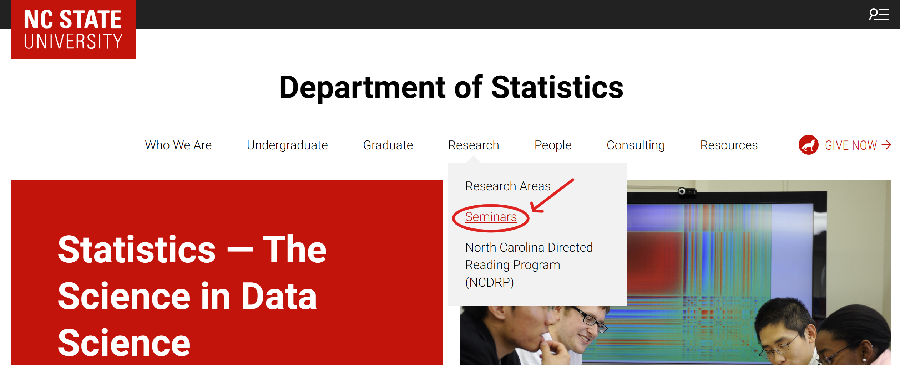

---
format:
  revealjs: 
    theme: night
---

## Statistics Experience {.smaller}

:::::::::: panel-tabset
### Brief Overview

:::: callout-note
::: {style="font-size: 1.3rem;"}
Unfortunately, I do not have any pictures or documentation from the seminar, so please check the slides tab for more about Dr. Tackett’s work!
:::
::::

:::::: columns
:::: {.column width="70%"}
::: {style="font-size: 1.7rem;"}
Last week, on November 6, I attended a seminar titled “Exploring Inclusive Teaching Practices in Introductory Statistics and Data Science,” held by NC State’s Department of Statistics, featuring Maria Tackett from Duke University! In it, she and 2 other researchers explored how 11 different instructors fostered inclusive learning environments in (mostly) introductory statistics and data science courses.
:::
::::

::: {.column width="30%"}
{fig-align="center" width="300"}
:::
::::::

### Reflection {.scrollable}

::: {style="font-size: 1.65rem;"}
- This wasn’t my first seminar, but it was the first I understood from start to finish, likely because its subject applied to everyone, regardless of their background. In that sense, the research may have partially achieved its goal. I already knew many students dreaded taking statistics \[to fulfill a requirement\] because they struggled to see its relevance. I found it interesting how professors addressed this by applying it to other fields. For example, an instructor teaching ST 311 or ST 371 to physics majors might use probability examples involving photon movement.

- I was also unaware that the [7 principles of universal design](https://design.ncsu.edu/wp-content/uploads/2022/11/principles-of-universal-design.pdf) were developed here at NC State, so it was neat to learn that the foundations for accessible design (and, indirectly, universal design for instruction (UDI) and learning (UDL)) were a creation of the Wolfpack! It’s comforting to know that statisticians are actively seeking ways to make the field I enjoy so much more inclusive in practice.
:::

### ST 115

- I feel this trend toward improving statistics pedagogy most in ST 115, in particular. I’ve never coded before, so you can imagine how convoluted the jargon can be; however, I've never felt left behind (especially in a new class that’s never been offered before!).

- The content and how it's presented (both in lectures and in the course setup) are intuitive and build on past activities. For example, we learned how to manipulate data sets (and data types) to graph them conveniently!

- Most of all, I don’t feel stupid for making mistakes. In fact, I often do extension questions before we get to them because I want to try them blind. ST 115 has easily reignited my fascination and curiosity with plotting data and coding in general.

### Slides/Citation

To read more about the seminar (and future ones), click [here.](https://statistics.sciences.ncsu.edu/event/statistics-seminar-maria-tackett/)

Here is a [link](https://matackett.github.io/SOCQS/ecots22-slides.html) to Dr. Tackett’s past work that may be relevant!

{fig-align="center" width="739"}
::::::::::

::: footer
Jay Agustin
:::
